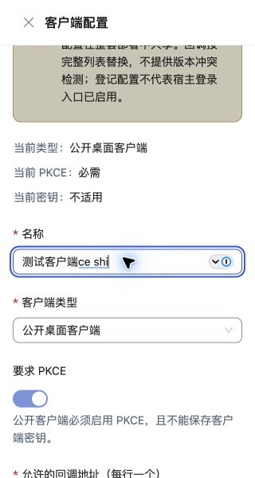
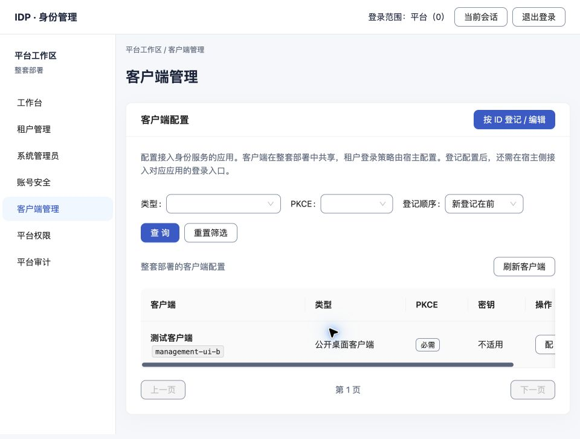

# 中文IME与最终视觉追加补验

日期：2026-10-24。范围：现有Mac Chrome 155.0.8059.85、macOS 26.6.2 arm64、系统简体拼音、H01独立参考后台。原约束保持：不推送、不部署、不启动M1-03–06，旁白不测。本次没有产品代码、依赖或构建变化。

## 结论与证据

- [results.json](results.json)：9组原生观察与对应保存值核对全部通过，不累计到上一轮重叠用例数。
- [native-observations.json](native-observations.json)：17步原生输入后的只读字段/弹层/视口观察；20张页面截图位于`assets/`。
- [database-readback.json](database-readback.json)：独立临时PG只读查询；名称精确为“测试客户端”，原回调、类型、PKCE保持。
- [visual-review.json](visual-review.json)：31张既有最终截图预览及重点原尺寸复核、本轮原生界面与新截图；未发现新增阻断产品问题。执行者复核完成，不代需求方最终签认，不作全状态或WCAG认证。
- [final-visual-dom.json](final-visual-dom.json)：恢复默认960×727/DPR2；document宽960，表格局部滚动可回到首列。
- [source-and-served-assets.json](source-and-served-assets.json)：上轮43项源码/制品未变，四入口实际JS/CSS与磁盘匹配。
- [tool-attempts.json](tool-attempts.json)：未生效/失败的自动化路径和处置，不将工具故障冒充产品失败或通过。
- [cleanup.json](cleanup.json)：新增1套夹具、4宿主、PG容器/匿名卷/私有目录已清理；会话退出、专用tab/group关闭、viewport override恢复。此前20套清理记录保持，合计21套。

## 实际操作与复验方式

1. 先核对上轮源码/制品摘要；以既有`prepare_management_navigation.py --image postgres:18.6 --isolated-cookies`另建loopback夹具。不读现存.env/业务库，使用合成管理员。
2. 在专用Chrome普通profile标签登录，打开客户端`management-ui-b`的名称输入框。系统快捷键为⌘空格，自动切换未生效；用户手动切到简体拼音并回复“已切换”，此后由CUA原生应用`pressKey`逐键输入。复验也须先确保实际输入源正确。
3. `c e s h i`显示带下划线的`ce shi`；Space落字“测试”。再次组合后Return实际确认字母`ceshi`，未打开保存确认。Escape取消当前组合并保留已有文字，未关闭抽屉。
4. 清空名称，`ceshii BackSpace Space`加`kehuduan Space`得到精确“测试客户端”。textarea追加`ceshi Space`得到一次“测试”，保存前恢复原回调。
5. 显式点“核对并保存”才出现完整中文摘要，点“确认保存”后重新读取，关闭抽屉回列表，随后独立数据库回读验证一致。
6. 租户名称筛选中重复组合Return和Space；组合/选字后仍显示原四个租户，显式点“查询”后才出现“没有符合条件的租户”。重置恢复列表。本次没有抓网络请求计数，不宣称零读取HTTP。
7. 320×600受控视口检查下拉和原生组合。清空名称点保存，必填错误可见且不弹确认；用真实拼音恢复中文后错误消失。未保存这次校验草稿。
8. 恢复默认视口，核对局部表格左右滚动与最终中文列表；退出临时会话、关闭专用标签，核对夹具所有权后清理。

系统候选窗未被Chrome页面/应用截图捕获，DOM composition事件流也未录制；证据是原生按键、系统marked text、Space转换和保存回读。未派发合成composition事件，未把`fill`直接写中文计为输入法通过。用户选择的简体拼音保留，系统快捷键/配置未修改。

## 视觉核对范围

沿N0 §6/N2 §7和当前浅色中文后台，复核平台/目标租户/Disabled作用域、稳定ID、危险后果、返回优先、长标识折行、窄屏、焦点、下拉、必填错误恢复、成功、无匹配、加载及审计/诊断样本。旧截图的洋红色字段为测试脚本遮罩；旧默认/错误/加载截图分别看待。187次布局、8项对比度及200%/400%原生操作沿用上一轮对应证据，不改称本次重跑。

未扩大到Windows、其他输入法/词库/候选设置、真实嵌入消费者、生产或全部视觉状态。正式需求方视觉签认仍单列；本轮执行者检查已完成，不需以重新设计或虚构签认收尾。

