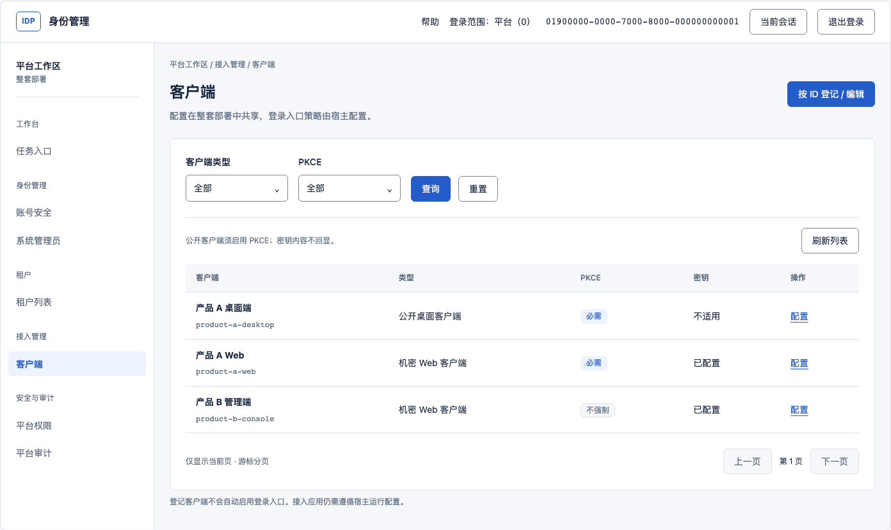

# UI-A 业务设计稿与交互说明

| 项目 | 内容 |
| --- | --- |
| 标识 / 版本 | IDP-CONSOLE-UI-A，修订 2，2026-10-20；按上位修订2及实际代码完成再核对 |
| 上位依据 | [管理后台与社区能力补齐详细设计修订 2](../../management-console-capability-design.md)，尤其 §4–6、§9–10 |
| 软件事实基线 | 本地 `main` / `6bed928964c67fa08d73ea61175e14bf3db7e65c`，3.0.0 / tenant_v6；未推送 |
| 交付状态 | UI-A 静态设计稿已完成，供审阅；视觉和交互候选未获定稿确认，UI-B–F 未实施 |
| 范围 | 平台客户端列表/配置，租户成员/资源授权/业务管理员授权，危险操作确认，登录/选租户、空/403/异常及窄屏 |
| 边界 | 仅设计资产与说明；无产品代码、依赖、API、配置或数据库变更，无提交；未运行产品验收，未启动 M1-03–06；试点/部署待定 |

## 1 如何审阅

先打开[完整静态业务稿](ui-a-business-mockups.html)，按画板一、二、三顺序查看。文件自包含，无脚本、外部字体、外部图片或 API 请求；按钮、筛选和表单不执行操作。缩放浏览器宽度可观察响应式排版。稿内所有名称、邮箱、ID和回调地址为合成示例，不代表实例现状。

若当前查看器不渲染 HTML，可直接查看这些渲染图：

| 场景 | 桌面 | 窄屏 |
| --- | --- | --- |
| 客户端列表 | [平台列表](assets/01-clients-desktop.png) | [390px列表](assets/07-clients-mobile.png) |
| 租户成员授权 | [资源范围侧板](assets/02-member-grant-desktop.png) | [390px授权](assets/08-member-grant-mobile.png) |
| 危险操作 | [全域改密确认](assets/03-password-confirm-desktop.png) | [390px确认](assets/09-password-confirm-mobile.png) |
| 管理登录 | [平台入口](assets/04-login-desktop.png) | [390px登录](assets/10-login-mobile.png) |
| 特殊状态 | [403](assets/05-forbidden.png)、[业务管理员确认](assets/06-business-admin-confirm.png) | [导航展开](assets/11-menu-mobile.png) |

补充：[客户端配置侧板](assets/12-client-editor.png)、[资源实例授权确认](assets/13-resource-grant-confirm.png)、[Choose选租户](assets/14-choose-tenant.png)、[成员列表](assets/15-members-desktop.png)。

本次再审：[问题、证据与修订记录](review-r2.md)。新增[ID定位](assets/16-client-id-lookup.png)、[角色分页选择](assets/17-role-choice.png)、[暂停成员](assets/18-member-pause-confirm.png)、[移除成员](assets/19-member-remove-confirm.png)、[跨标签变化](assets/20-session-changed.png)、[写成功后读失败](assets/21-write-readback-failed.png)、[390px成员移除](assets/22-member-remove-mobile.png)，完整画板对应 A01.1、B01.1、C02.1–2、C05。

## 2 结构、视觉与复用

当前组件基础是 Ant Design 5 / React 19。候选采用白色侧栏和顶栏、浅灰工作区、蓝色主操作、列表—详情侧板—确认层级，减少原登录介绍页的留白。独立设计稿用原生 HTML/CSS 表达视觉，**不作为另一套待接入的组件实现**；后续仍映射现有 antd Layout/Menu/Table/Form/Drawer/Modal/Alert。

| 设计项 | 本稿选择 | 实施边界 |
| --- | --- | --- |
| 布局 | 平台工作区与租户管理；顶栏同时显示登录身份，租户页单独显示管理目标 | 平台切目标不签发新会话；Disabled文案为系统管理 |
| 容器 | 白色面板+细边框；无层叠阴影、渐变或装饰插画 | 弹层/侧板仍沿用 antd 行为；不能照抄静态稿替代焦点与滚动管理 |
| 字体 | 系统中文字体，正文14、说明12、标题24；中文行高1.7；ID等宽 | 不新增在线字体，不用细小灰字承载操作后果 |
| 色彩 | 主色 `#245CCA`；正文 `#17243B`、次文字 `#58677C`；背景 `#F5F7FA`、面板白 | 状态有文字；确认危险操作用 `#B42318`，不只靠颜色区分 |
| 间距/圆角 | 4/8/12/16/24/32/48；控件6、面板8；内容边距24 | 窄屏边距16；长ID可折行，宽表格局部横滚 |
| 几何 | 侧栏240、顶栏目标56、侧板600、确认框最大560、登录卡最大416 | 顶栏可因身份/操作换行增高；长侧板在真实视口内正文滚动，按钮不遮字段 |
| 图标 | 这版以文字导航为主，无功能图标依赖 | 后续如加入图标须统一一套并声明直接依赖，不影响标签可读性 |
| 动效 | 本稿无动效 | 后续仅状态和弹层短过渡，遵循 reduced-motion |

侧板尺寸600是本轮业务稿的候选值，落在现有管理侧板尺寸附近；不修改公共组件的默认宽度。没有选择 ProComponents、路由库或 shadcn 迁移依赖。

可复用入口：`web/management/main.tsx` 的唯一 meta、`ManagementClient`、`web/embedded/browser-session.ts` 的协调与现有页面服务。菜单、地址和 `Capabilities` 均不是动作授权矩阵。所有写操作继续由服务器检查最新权限和状态；版本/原状态断言按各接口已有契约，不推导每个动作都有CAS。

顶栏依据已验证session显示“登录范围：平台（0）/租户ID/系统（0）”和账号ID，不从域0推断“已获系统管理员角色”。样张假设相应管理读取已成功，操作仍可能被拒绝。“当前会话”复用既有身份详情与校验动作，窄屏隐藏长ID时仍可查看账号/session/client和会话范围。验证会话不等于取得管理动作权限。

## 3 画板一：平台客户端

### 3.1 A01 列表与登记入口

主任务是按类型/PKCE查找客户端并配置；字段只用 client_name/client_id、client_type、pkce_required、client_secret_configured。客户端按整套部署共享，不显示虚构的所属租户、接入数量、运行入口状态或“已发布”。

- 查询只支持现有的客户端类型、PKCE条件；查询/重置从第一页开始。ID 精确查询归到“按 ID 登记 / 编辑”，不伪装为名称搜索。
- 页码只是当前游标栈位置，有上一页/下一页，无总条数、最后一页或随机跳页。本稿少量记录按第一页且has_more=false呈现，两按钮禁用；真实has_more=true才启用下一页，不推算剩余数。
- 配置操作保持可见。无删除、停用、发布配置、生成密钥或复制已有密钥按钮。
- 工作区不读取本地进程环境或扫描配置文件来补入口关联。客户端登记完成不代表新模式业务入口已启用。

### 3.2 A02 配置侧板

顺序：输入合法 ID → 读取 → 已有则编辑 / 404则登记 → 填写 → 核对完整配置 → 明确确认保存 → 回读配置。403、网络错误和解析错误均不得转成“新客户端”。ID 限制沿现有校验，最多128位字母、数字、点、下划线或连字符。

A01.1给出输入ID后“读取配置”的定位层，复用原getClient，不新增搜索接口；只有已确认挂载正常的客户端资源查询404才使用现有登记分支。其他对象404只显示不存在/不可见，不能泛化为创建；认证/能力入口404提示宿主入口不可用。

| 字段 / 分支 | 设计行为 |
| --- | --- |
| 名称 | 必填；沿用256字节/控制字符限制 |
| 公开桌面客户端 | 强制PKCE；无密钥输入；回环地址或应用专用协议，不能提示普通HTTPS也合法 |
| 机密Web客户端 | 保留原PKCE选择；HTTPS或回环地址按现有规则验证 |
| 回调地址 | 每行一个，完整列表替换；沿用最多32个、单个2048字节及服务端URI限制 |
| 已有机密密钥 | 留空保留；填写表示替换，确认区只显示“保留/替换” |
| 新机密客户端 / 公开转机密 | 按现有要求提供新密钥；最大4096字节、首尾无空白 |
| 机密转公开 | 确认区明确“已有密钥将清除”；不能以隐藏输入暗中保留 |

逐字段上限不等于请求一定可提交：现有client及Axum另限制整个JSON请求16 KiB。超限在发送前说明需减少回调/字段内容；未发送的本地校验失败不标为“写入未知”。资源授权的resource ID沿现有1–256位字母、数字、点、下划线、连字符限制，不用客户端ID的128位上限代替。

确认区显示最终类型、PKCE、完整回调集合和密钥处理方式。范围提示为“整套部署中使用此客户端的应用”；明确回调是完整替换、无版本CAS、并发可能覆盖、不自动撤销已有会话。重新读取会清理旧草稿，先提示放弃；不能声称回读消除了并发风险。

响应未知时阻止直接重复保存，先回读原client ID。密钥只可回读“已配置”状态，不能据此断言新密钥已写入；需要接入方核对。密码/密钥不进URL、持久存储、截图示例或变更摘要。

## 4 画板二：租户成员与授权

### 4.1 B01 身份与模式

样稿主场景是 Enabled 平台会话管理 `tenant-a`，其会话域仍为0；相应权限须由管理操作结果确认。成员列表分别显示全局账号状态和本租户成员关系，不能合并为一个“用户状态”。查询沿现有邮箱筛选，无角色数/资源数聚合。

| 身份 / 模式 | 可出现的任务入口 | 不适用入口 |
| --- | --- | --- |
| Enabled，平台会话0，目标非0 | 成员角色、成员关系、关联已有账号、新建账号、管理员授权、账号安全，实际动作由服务器检查 | 不把目标选择称为登录切租户 |
| Enabled，Fixed/Choose非0会话 | 本租户成员角色与成员关系；真实Choose入口保留原切租户流程 | 不展示平台账号创建/关联、管理员任命、账号安全或任意目标选择 |
| Disabled，系统会话0 | 系统成员角色、新建账号、专用管理员授权、账号安全、客户端 | 不展示租户选择/租户创建/Enabled成员移除/关联已有账号流程 |

上述是当前页面/接口约束的呈现，不新增角色或委派规则。`members.tsx` 的管理员授权/账号安全入口当前仅给会话域0；本稿保留该边界，不凭“租户管理员”名称扩大任命权。已有管理员仍由专用 `AdministratorDrawer` 管理，不能从普通业务角色页编辑保护角色。

### 4.2 B02、B02.1 普通业务角色

任务链：成员 → 角色分配 → 按可选business_id查询角色 → 读取选中角色详情 → 选择资源类型与明确范围 → 预览 → 确认 → 回读分配。B01.1展示真实游标角色列表，不把当前页当作全量可选项；B02改为已选角色摘要和“重新选择角色”，不画成可随意修改的业务字段或全量下拉框。

换角色或业务先清除旧资源类型、范围、资源ID和确认摘要，再读取新角色；迟到响应按session/target/business/subject/role上下文丢弃。

- 对象上下文始终为 `(tenant_id, business_id, subject_id, role_id)`；实例分支再加 `resource_type/resource_id`。草稿和响应不能跨上下文复用。
- 普通业务角色只可选有效的业务角色，资源类型来自该角色当前权限；无权限角色不出现可提交授权。
- 范围初始必须未选，不能静默默认“全部资源”。稿件显示的是用户主动选中instance后的状态。
- instance填资源ID；type不保留或提交旧资源ID。确认区展示当前动作及其随角色权限变化的事实，type分支明确覆盖以后新增的该类型资源。
- 角色停用、账号停用或成员非active时禁止新分配，并说明需先处理的状态；提交仍由服务器复查。
- 回读分配成功不能证明业务资源存在或归属，真实资源由产品宿主负责。

分配/撤销绑定接口不传expected_role_version。角色详情只是预览时快照，服务端在提交事务中按当前角色状态、有效权限和成员状态判断；预览与提交之间权限可能变化，不能声称版本锁定了展示动作。授权后的权限继续动态变化。撤销定位原binding ID；角色名称、key和ID帮助核对，但不是可提交的角色版本锁。

### 4.3 B03 业务管理员

选择 `business_admin` 后走独立摘要：整个business范围，包含当前和以后新增的全部有效业务权限；隐藏资源类型和资源ID，不带旧type/instance草稿。确认“授予业务全部有效权限”，同时说明不获得IDP管理权限。保护管理员另走专用任命接口，不与业务管理员合并。

撤销业务角色绑定列出原目标、业务、角色、资源范围，只撤这条绑定，保留账号/成员/其他角色。不能承诺撤销后一定完全失去该资源访问权，因为其他有效授权可能仍存在。

## 5 画板三：危险操作与恢复

### 5.1 确认结构

确认分为“明确动作标题 → 主体与稳定ID → 目标及范围 → 实际后果 → 返回修改/明确提交”。高影响后果放在按钮前；不增加与已有接口无关的理由必填、邮箱复输或二次密码挑战。尚无step-up能力时不画成已支持。

| 操作 | 必须确认的范围 / 后果 | 保护及恢复 |
| --- | --- | --- |
| 全局改密（C01） | 该账号所有域的session、refresh、authorization code、未完成tenant selection退役；UI文案为“所有域的现有登录和待完成登录失效” | 不显示密码；自己改密清凭证后重新登录；不缩成当前租户影响 |
| 全局账号停用 | 阻止登录、退役现有凭证；保留共享账号与局部成员的区别 | 最后有效管理员保护；启用不恢复旧凭证；closed仍只读 |
| 撤销角色绑定（C02） | 当前tenant/business中的原binding ID，保留其他授权 | 不传role版本；当前绑定/角色由服务端复查，冲突或404先回读 |
| 撤销保护管理员 | 仅撤该域管理员权限，保留账号/成员/业务角色；自己撤权可能无权继续 | 不撤最后有效管理员；不借普通角色接口或补建身份绕过 |
| 暂停/恢复租户成员（C02.1） | 暂停终止本租户session/refresh、授权码、邮箱验证码，并撤销该账号以此租户为来源或无来源域的选择票据；保留角色/设备绑定，恢复后重新登录 | 仅suspended且账号active可恢复；不改全局账号密码，不统一撤其他租户既有会话 |
| 移除租户成员（C02.2） | 包含上述登录/验证/选择清理，另删除本租户角色绑定、解绑设备，不删除全局账号 | 最后一个未removed成员关系受保护（包括suspended，不等同最后active关系）；removed不可直接恢复，须平台重新关联且不恢复旧角色/设备绑定 |
| 撤销会话 | 明确单session或目标域内该主体会话，不说“全平台退出” | 原返回/回读确认，独立会话对照留给后续验收 |
| 客户端覆盖/换密钥 | 部署级完整配置/回调替换、Secret保留或替换、不自动撤已有会话 | 无CAS限制可见，结果未知先核对原对象 |

只有直接失效/撤销等危险操作用红色主按钮；授权使用蓝色但保留范围警示。提交时禁重复、禁遮罩关闭、禁切目标；返回修改保留非敏感字段，密码/Secret按原页面边界清理并要求必要时重输。

并发约束逐接口保留：租户/角色维护与成员状态使用现有expected_version；账号状态用expected_status；绑定分配/撤销、管理员任命/撤销、账号密码和client upsert没有角色版本CAS。服务端当前状态检查和事务回滚不等同预览快照被锁定。不得为满足本稿虚构expected字段或新增写前协议。

### 5.2 反馈闭环

| 状态 | 呈现及下一步 |
| --- | --- |
| 等待提交 | 原对象/范围仍可见，提交按钮显示处理中且不可重复；不预先写“已成功” |
| 成功 | 有效成功响应确认写入；持续结果区写明对象/变化/范围，回读用于更新列表。成功后读取失败显示“写入已确认，读取失败”，不得改称写入失败或再提交 |
| 409/状态冲突 | 现有普通request只保留HTTP状态，不保留领域细分code；统一说明“操作与当前状态冲突”，回读核对，不据409臆断必为last_security_admin或version |
| 写入未知 | 无成功确认的超时、断网、5xx或响应解析/作用域校验失败先核对原目标，不自动重试；普通接口没有request ID结果查询或幂等重放契约 |
| 普通资源403 | 会话仍有效则保留，显示当前身份/请求目标和返回可用范围；不显示空结果，不自动换租户 |
| 普通资源401 | 原client清认证后进入登录，清敏感数据，不保留旧权限判断 |
| 跨标签sessionChanged | 独立显示“其他页面已更改此会话”与重新加载，不仅给重新登录按钮；仍服从原Coordinator |
| restore/refresh失败 | 不套用普通读取的“可重试”逻辑，不保留失效旧凭据，不重放refresh；开发403遵循原限制 |
| 429/5xx/404 | 读取按状态提供稍后重试或回读；429不编造倒计时/新增限流能力，写入遇5xx先核对。资源404不自动换目标或推断全局不存在 |
| 退出响应未知 | 本地凭证已清理不等于服务端退出已确认；沿用原client错误/协调结果提示核查，不承诺全部独立会话结束 |

密码与Secret无法靠GET证明新值已提交；账号状态不变化也不能证明改密失败。丢失改密响应后不得自动再改密码，先按已有会话/运维边界核查。若已失去核对权限，保留“不确定”结论，交由有权管理员处置，不借再次登录成功/失败推断完整撤销范围。

## 6 登录、空状态与窄屏

### 6.1 C03/C05.1 登录

登录卡只保留身份管理标识、入口说明、邮箱、密码和登录。以下文案均来自真实能力，不固定写死平台：

| 入口 | 副标题 / 后续 |
| --- | --- |
| Enabled Fixed0 | 此入口用于平台管理员登录 |
| Enabled Fixed非0 | 此入口仅登录租户 `{fixed_tenant_id}` |
| Enabled Choose | 验证账号后，选择已加入的租户；沿用selection ticket/游标/有效资格，选择不可进入平台0 |
| Disabled | 使用管理员邮箱和密码登录；进入系统管理 |
| 私网开发browser | 明确提示刷新或会话到期后需重新登录，不提供恢复/续期承诺 |

先读取能力并按现有机制恢复，期间不显示旧管理数据。登录失败保留邮箱、清密码，使用现有client的安全错误映射，不披露账号是否存在；无“记住我”、注册、忘记密码、SSO或MFA入口。能力读取失败提供重新连接；普通401、跨标签变化、恢复失败按§5.2分支，不共用一个按钮。

Choose首次登录取消为“返回登录”，从已有会话发起时为“取消切换，返回当前会话”；源会话仍有效才可继续访问，取消不证明其仍有权限，处理中禁重复。租户和成员均active才可进入，暂停/归档/移除状态不可进入；上一页/下一页沿现有游标。票据过期/401结束该选择，重新按client状态登录或发起选择，不循环重试失效票据。零可用租户与列表读取失败分别呈现，不伪造创建租户入口。

token/API-only和仅browser无UI的组合不提供管理页面；本稿只展示开启UI的管理入口，不改变M1-02可选browser/UI契约。

### 6.2 C04/C05 空与异常

“未筛选且成功读取为空”“筛选无匹配”“读取失败”“无权查看”四类分开。清筛选只改变页面条件；读取失败保留条件并重试。首次空列表只在合法宿主确实返回空时使用；当前M1-02启动要求已有管理client，不能为展示空状态删除该配置。主要可复现的客户端空结果是筛选无匹配。

403页展示明确请求目标，但不从未经授权接口补目标名称或账号资料。稿中“产品A”是已知上下文；只有未经验证的URL目标时只显示经过格式校验的目标ID。返回当前管理范围也要重新校验，若当前范围同样无权，继续显示局部403；不得无限重定向或直接退出仍有效会话。没有“申请权限”发送按钮或自动消息能力。

### 6.3 窄屏与键盘约定

| 宽度 / 容器 | 行为 |
| --- | --- |
| 1024及以上 | 240侧栏；表格占剩余宽度；字段与动作同行但可换行 |
| 768–1023 | 192侧栏，内容边距收至16；帮助入口收起，身份和目标仍保留 |
| 低于768 | 侧栏改“菜单”抽屉；页面操作换行；筛选纵排；只允许表格自身横滚 |
| 侧板窄屏 | 全宽任务视图，保留主体/身份/目标；长ID折行，取消/预览紧随内容，不遮住字段 |
| 确认窄屏 | 满可用宽度，按钮按DOM顺序纵排；返回/取消在前、提交在后，不用CSS视觉逆序 |
| 登录窄屏 | 居中卡片改占可用宽度，输入可缩放，标签不依赖placeholder |

后续实现键盘要求：跳过导航到页面标题；菜单有当前页语义、可键盘关闭；侧板/确认有名称、进入焦点、焦点约束、Esc规则及返回原触发器（不存在时回到列表刷新）。危险确认初始焦点放返回/取消，避免Enter误提交；处理中按原业务规则禁关闭。错误信息与字段关联并可被读屏读取，成功/异步状态有适当播报。目标切换、前进后退和地址编辑共用草稿/未知写入离页检查。

本稿没有用静态按钮模拟这些交互，因此渲染检查不证明键盘、读屏、触屏横滚和真实浏览器会话已验收。

## 7 UI-A 核对与后续交接

| 覆盖要求 | 设计位置 | 对应后续断言 |
| --- | --- | --- |
| 平台客户端列表与已有配置 | A01/A02，§3 | UX03/05/07/08/10/11 |
| 租户成员授权与管理员区别 | B01/B02/B02.1/B03，§4 | UX01/02/04/09/15/18 |
| 危险操作范围与恢复 | C01/C02/C05，§5 | UX09/10/11/15/17 |
| 登录、恢复与Choose | C03/C05.1，§6.1 | UX01/02/06/17 |
| 空/403与异常 | C04/C05，§6.2 | UX07/10/19 |
| 窄屏、焦点和可访问性设计 | 所有响应式画板、C06，§6.3 | UX12/13/14 |

UI-A已完成字段/操作的源码静态核对，以及本地HTML桌面/窄屏渲染检查；没有运行Web/Rust测试、产品构建、数据库或宿主服务器。静态稿无脚本，无HTTP请求；在320、390、768、1024、1440视口下页面整体无横向溢出，宽表格保留局部横滚。已修正桌面侧板底部裁切、窄屏品牌换行和确认按钮视觉/DOM逆序。截图是设计证据，不是产品运行截图。

按本稿纯色值计算，主色/白色对比度6.07:1，正文/白色15.53:1，次文字/白色5.76:1；危险、成功、警示文字与各自底色均超过4.5:1，控件边界/白色3.63:1。该计算只覆盖所列纯色组合，不代表真实组件的全部状态、焦点、缩放或整体WCAG合规已经通过。22张PNG与最终HTML同步生成；本地相对链接、重复ID、脚本与外部资源引用已核对。

后续UI-B可据此拆壳层与页面分发，但须保留全部现有任务入口和认证状态机；本次没有启动。视觉候选仍需审阅，重点是信息密度、侧板形式与确认文案。新增身份能力沿原独立专题，M1-03–06、试点和部署继续待定。
