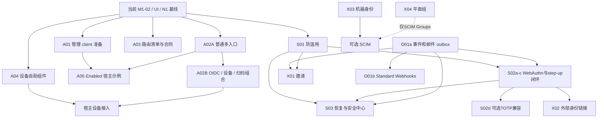

# 剩余产品能力实施方案

| 项目 | 内容 |
| --- | --- |
| 修订 / 日期 | 修订 4，2026-10-25；同步开源API/许可复审、实际代码边界与实施依赖修正 |
| 输入 | [剩余产品能力技术设计](product-capability-completion-design.md)修订4；审查开始本地 `de50eb9`，相对修订2 `d721481` 的crates/web/examples无差异；3.0.0 / tenant_v6；初稿基线 `8fd9f46` |
| 修订4设计阶段产物 | 设计和方案文档；后续按批实施进度另见下方记录，未执行完整验收和部署 |
| 编号规则 | 保留 M1-03/04/05/06、C05–C13 的历史含义；A/S/X/O/U 为本方案能力索引，不替换既有工作包 |

修订4收尾复核HEAD为`6442583`，crates/web/examples相对产品基线`d721481`仍无差异；并行N2提交和诊断证据不纳入本轮产物。

实施进度（2026-10-25）：A01代码与局部验证见[第一批实施记录](a01-implementation-result.md)；A02A普通业务入口与A03本批合同/漂移检查见[第二批实施记录](a02a-implementation-result.md)。第二批复审另补受限browser票据用途隔离、短会话切换期限保护，以及并发/回滚和17操作合同负例验证（详见第二批记录）。第三批按依赖推进A02B-B1（配置v2、共享OIDC分派），见[第三批实施记录](a02b-b1-implementation-result.md)。第四批推进 A02B-B2设备 proof/admission，配置与局部测试见[第四批实施记录](a02b-b2-implementation-result.md)。第五批按先设计、双重复核、再实现推进B3扫码组合，见[B3技术设计](a02b-b3-technical-design.md)、[B3实施方案](a02b-b3-implementation-plan.md)和[实施记录](a02b-b3-implementation-result.md)。以下仍保留修订4的计划基线；A03历史全量schema及完整验收未因此完成。

## 当前进度快照（2026-10-26）

本节是当前状态；下文保留修订4的设计与依赖基线。这里的“已完成”仅指所列切片实现及局部验证，不代表整个产品、完整验收或生产部署完成。本次将此前未提交的 A02B-B2/B3、A04-A～D、A05 与合同更新一并归档到本地提交；不推送。

| 能力 | 当前状态与证据 | 剩余边界 |
| --- | --- | --- |
| A01 管理client显式准备 | 已完成，见[记录](a01-implementation-result.md) | 生产配置与运行验收另列 |
| A02A 普通业务与多入口组合 | 已完成，见[记录](a02a-implementation-result.md) | 完整宿主组合矩阵另列 |
| A02B-B1 配置v2与OIDC分派 | 已完成，见[记录](a02b-b1-implementation-result.md) | 不等于外部OIDC身份联邦 |
| A02B-B2 设备proof/admission | 已完成本批接线，见[记录](a02b-b2-implementation-result.md) | 真实平台可信准入由宿主提供 |
| A02B-B3 扫码组合 | 已完成本批，见[记录](a02b-b3-implementation-result.md) | 实体设备及完整场景验收另列 |
| A03 接口合同与漂移检查 | 本轮新增/修改接口已同步，路由清单及生成检查已落地 | 随后续切片持续维护；历史所有接口schema全集为可选扩展 |
| A04-A 本人设备与解绑 | 已完成，见[记录](a04-a-implementation-result.md) | 局部验证范围以记录为准 |
| A04-B 登记、signer/admission与恢复 | 已完成组件及真实协议局部接线，见[记录](a04-b-implementation-result.md) | 不代表原生安全持钥完成 |
| A04-C 双签轮换 | 已完成本批，见[记录](a04-c-implementation-result.md) | 原生keystore、持久操作状态及跨进程锁待目标宿主适配 |
| A04-D 可选扫码交互 | 已完成本批，见[记录](a04-d-implementation-result.md) | A04整体平台交付仍未完成 |
| A05 Enabled嵌入示例 | 基础示例已完成，见[记录](a05-implementation-result.md) | 不是生产宿主；不包含全部设备接入组合 |

本地分支整合补充：注册邮件/预算及物理数据库超时的候选基础已随工作分支整合，见[整合记录](branch-integration-2026-10-26.md)。S01/O01a启动前须先盘点复用，不能重复实现，也不能据此把上述完整切片标为完成。此整合仅在工作分支，不代表已合回main。

### 待推进及实施顺序

1. **S01 防滥用**：下一批优先；先详细设计和double check，完成入口清单、可信来源、累计预算、容量与密码计算并发控制，再接线和局部测试。
2. **O01a 最小安全事件与邮件outbox**：补类型化投递结果、加密payload、事务事件、租约及重试，为S02/S03/X01提供前置能力。
3. **S02a–c WebAuthn/MFA/step-up闭环**：依赖S01与O01a，包含旧入口保护及最低因子丢失恢复后才能开放；S02d TOTP按需后置。
4. **S03 自助安全中心与恢复**：本人会话、改密、匿名恢复及因子管理；不涉及MFA的本人会话子集可独立推进，完整恢复按依赖实施。
5. **A04 原生平台适配**：目标平台确定后推进真实keystore、持久状态和跨进程协调；与上述安全切片分别交付。
6. **按真实消费者选择**：X01邀请（依赖S01+O01a）、X02a外部OIDC（依赖S02c）、X02b LDAP/SCIM、X03机器身份、X04组与委派、O01b外部Webhook。不是首版必须全部实现的清单。
7. **O02/U01 软件增强**：密钥快照/热装载、运行诊断与恢复屏障、管理端client CAS等逐项立项；软件实现与实际运维演练分开。

S/X/O/U以上新增切片尚未按本方案完成，不把现有密码登录、邮件发送、审计或密钥配置等基础代码等同这些增量能力已交付。A03随每批同步。完整验收、生产部署、实体设备验证、容量与灾备演练仍单列，不在本次提交范围。

局部测试证据沿用各切片实施记录；另有[CI迁移与退役记录](n2-retirement-implementation-result.md)记录本机集成与关键浏览器回归，其历史通过结果不替代目标Linux/远端CI或完整产品验收。

## 1 交付范围与完成口径

方案覆盖全部已识别的非验收产品工作，但不等于全部候选增强必须进入首版。既定接入缺口、体验补齐和候选增强分批独立交付；能力范围需要在对应切片启动前固定，不能边写代码边扩大产品目标。

“开发完成”需要：公共合同和权限边界明确；真实代码落地；必要 schema/显式迁移及兼容说明齐备；局部功能和安全回归通过；调用方/界面可用；失败和结果未知可处理。“完整验收完成”另需真实环境、宿主、实体设备、容量、恢复演练等证据。本方案不把两者合并。

在分析基线`8fd9f46`，N2工具122项离线检查不能代表264项产品功能断言已经通过。文档收尾时另一任务已启动后续CI实际补验并推进至`d721481`，其结果由所属执行记录维护，本方案不覆盖或冻结其状态。本轮不运行这套完整选集，也不执行 M1-06。后续每个切片只提供开发证据与剩余验收项，不标记生产就绪。

## 2 推荐顺序与依赖

推荐先完成A01、A02A、A03初版，使新配置下普通身份功能形成可接入的软件链，再补A02B、A04/A05。S01可在接口盘点后推进；S02/S03共用安全挑战与账号退役约束，串行集成。O01a最小安全事件/邮件outbox是S02/S03/X01的前置子集，不能推迟到功能写完后各自补一套；O01b外部webhook、X系列与其他O/U增强仍按消费者选择。章号不是所有切片的执行时间顺序。

每个首次引入组件的切片先做G0复用核查，随后实现薄adapter和领域接线，不把六个库一次加入仓库。S02内部顺序为共同合同及WebAuthn→登录/旧入口保护→step-up和最低因子丢失恢复闭环→按需TOTP；S02c包含受限重新登记、受控离线恢复机制/说明，不反向等待S03完整安全中心。S02a–c形成首个可开放的WebAuthn安全批次，S02d不再是它们的前置。X01同时依赖S01及O01a。A01/A02等既定缺口不等待全部候选安全/联邦选型。



图表示主要依赖，不代表所有节点默认启动。A03随接口切片更新；O01a最小事件/邮件outbox先于外部webhook。S03中不涉及MFA的本人会话子集可独立推进，但完整因子恢复依赖S02；SCIM Users只依赖受限机器身份和目录映射，Groups另依赖X04，不要求先做OIDC broker。A04组件可用夹具先行，但真实登记退出须完成宿主admission、challenge及认证接线；可复用旧参考组合，不必等整个A02B。设备/扫码不属于A05基础示例的强制退出项。

## 3 开发前固定的共同产物

每个切片在第一份产品 diff 前提供一页范围记录：实际 HEAD、拥有文件、复用服务、拟改公共接口、支持组合、非目标、schema 影响、故障恢复、开发用例及剩余完整验收项。具体结构允许直接放入切片报告，避免再建设流程平台。

主代理负责架构、公共 API、数据模型、依赖策略和最终集成。仅对不重叠的调查/测试/文档分工；Core/存储事务与同一装配器改动由一个集成负责人串行落地。并行执行者不得重置他人工作区。

实现前确认仓库当时状态。现存无关 `docs/m1-02-code-review.md` 修改不属于本任务，不覆盖或纳入提交。生成的 web/dist、依赖目录、数据库、密钥和环境配置不进入版本库。

### 3.1 G0：按切片执行的开源复用核查

组件名称、归属和非复用部分已在[设计§2.1](product-capability-completion-design.md#21-复用原则与组件选型)确定；G0用于锁定可实施版本，不重新从零选型，也不是完整产品验收。本轮只写要求，不安装依赖或执行试验。

| 顺序 | 后续实施动作 | 必须产出的证据 |
| --- | --- | --- |
| G0.1 | 核对首选库官方release/tag与维护/安全公告、许可文件、features和传递依赖 | 组件/精确版本/来源及校验信息、发布日期、许可/NOTICE清单、已知安全问题及处置；默认分支版本号不当作已发布版本 |
| G0.2 | 对照目标Rust/MSRV、Mac/Linux、Axum/http/TLS、原生链接及已有依赖；检查最终feature合并结果 | 版本兼容表与必要升级影响；Core不被迫加入HTTP/网络/全部新增因子算法，已有argon2/sha2保留；显式记录WebAuthn的OpenSSL构建/运行依赖，不能假定现有ring即可满足 |
| G0.3 | 在隔离、无真实凭据的adapter试验中验证成功路径和协议关键负例 | 下表指定的最小复用证明；官方向量与本地领域负例分开，不能只调用happy path |
| G0.4 | 审阅适配边界并锁定版本，保留许可归属；失败则记录具体不满足项 | 进入切片的依赖/features、薄adapter合同、未覆盖项；无法满足时更新方案并选择兼容release或明确替代，不能悄悄手写协议/复制整库 |

G0证据附在各切片报告内即可，不新建通用依赖管理系统。实际引入时按仓库方式更新Cargo清单/锁文件；仅使用相关组件的宿主启用对应功能。MPL覆盖文件的使用/修改及源码提供边界单列，不能把上游复制代码标为本仓库MIT；外部文档或商业版功能不算OSS实现证据。许可证事实与官方来源以[设计§2.2–2.3](product-capability-completion-design.md#22-许可证与版本门槛)为准。

许可核查以选定发布包的LICENSE/文件头为准：utoipa的MIT OR Apache-2.0可择一；Standard Webhooks的Rust包MIT与规范/根目录Apache分别记录；MPL覆盖文件的源码获取说明和二进制/容器分发义务按交付形态落实。原生OpenSSL及传递依赖另列。上游默认分支/API核查不是release兼容或完整许可证审计，未验证时不启用能力，也不改用浮动master绕过G0。

### 3.2 组件实施与复用证明

| 组件 / 许可 | 接入阶段及归属 | 最小复用证明 / 本项目补充责任 |
| --- | --- | --- |
| OSS-05 utoipa / MIT OR Apache-2.0 | A03路由清单之后；HTTP合同层 | 输出OpenAPI 3.1.0；覆盖分散DTO及所选动态响应，不违反孤儿规则；security/动态挂载映射、手工扩展无重复；Core不加注解，不默认升级Axum |
| OSS-04 governor / MIT | S01；宿主准入adapter | 单调时钟、多维键、过期清理及硬容量拒绝/汇总；活跃桶不被淘汰重置预算；阻塞工作真实结束才还并发许可；共享store另验 |
| OSS-01 webauthn-rs / MPL-2.0 | S02a；Security可选adapter | 默认features关闭、仅有界启用服务端状态序列化；Mac/Linux OpenSSL及MSRV验证；稳定UUID handle、RP/origin/实际UV、注册后认证、重放/并发及状态升级读取 |
| OSS-02 totp-rs / MIT | S02d按需；Security可选adapter | 所选release显式时间返回匹配step；官方向量、时间窗/重放、同counter并发、密文key轮换；不用当前step冒充匹配结果 |
| OSS-03 openidconnect-rs / MIT | X02a；拟新增可选embedded-idp-federation | 精选HTTP/TLS features、受控网络、库verifier/Clock及JWKS轮换；库验证后补azp和多audience策略；接本地MFA/state/link/成员事务，不替换Provider |
| OSS-06 standardwebhooks / MIT；规范Apache-2.0 | O01b；拟新增可选embedded-idp-delivery | 官方独立语言SDK互验；原始body、300秒窗口、显式Clock、单key实例组合双签、数值/头歧义边界；outbox/租约/原子去重/SSRF归本项目 |

官方仓库和许可链接见设计§2.1；未完成G0的行不能记为“已接入”。现有ring/argon2/lettre保持复用；不为表中选型安装Keycloak/Ory/Kanidm/Rauthy/ZITADEL服务。Rauthy/Kanidm优先用于Rust流程对照，Keycloak/Ory用于交互与协议边界对照；ZITADEL仅设计参考，不引入AGPL代码。LDAP/SCIM库在X02b消费者确定后单独核查，目录协议类型不能代替成员事务和授权。

新增两个可选基础设施crate只随X02a/O01b各自创建，不预建框架；Core先定义本项目领域合同，第三方类型/序列化不泄漏到公开Core API。O01a先复用Email和参考app有界worker，事务由Postgres实现；worker启停/配置归宿主。业务时间沿现有SystemTime Clock，governor/执行截止时间用单调时钟，TOTP/OIDC/Webhook显式适配时间。所需密钥供应、超时/并发预算在各切片内交付，不以等待O02完整控制面为由推迟安全前置。

## 4 既定接入与体验切片

### 4.1 A01 / M1-03：显式准备

| 顺序 | 改动责任 | 交付 |
| --- | --- | --- |
| 1 | Core 新增受限 preparation 合同，复用 OidcClient 校验 | 创建/匹配/冲突结果；完整字段比较；系统准备审计模型 |
| 2 | Postgres 客户端存储事务 | 唯一键竞争、锁定回读、仅创建审计；不调用在线 upsert 覆盖 |
| 3 | app 配置解析与新离线命令 | 同源 DB/schema/mode/TLS/CA、独立定义文件；结构校验与启动能力校验分开 |
| 4 | 开发脚本和文档 | 操作示例、退出码、冲突处置、未知结果核对；旧 bootstrap/seed 不改语义 |

主要文件：`crates/embedded-idp-core/src/access/bootstrap.rs` 或紧邻的新 preparation 模块、`crates/embedded-idp-storage-postgres/src/access/`、`crates/embedded-idp-app/src/composition_config.rs`、`main.rs`、拟新增命令文件和定向测试。新增 trait 默认可选，不强制旧嵌入宿主实施离线命令。

开发用例：同定义并发最多一次创建/审计；异定义并发只能一方创建另一方冲突；合法已有对象直接匹配；类型/PKCE/secret/回调冲突不更新；COMMIT 回执丢失后安全回读；错 schema/mode/SecretRef 拒绝且无 secret 输出；旧参考启动和管理员初始化回归。

退出：P3真正可执行；P4用空business_entries完成readiness、管理引用检查和无自动准备写入的启动，然后在隔离环境验证管理登录（登录本身仍正常创建session），再经已有管理API完成一次P5对象准备，明确关闭不需要的公开注册。P6归A02，不把完整P1–P6验收加回本切片。回退停用新命令，保留已建client不自动删除。离线系统审计与创建同事务；现有管理context不支持非人员actor，采用独立最小准备审计投影，发生schema增量时显式迁移。

### 4.2 A02A / M1-04：普通业务组合

先核对已有普通refresh/logout的服务与HTTP实现，提取窄暴露面的薄Axum router；已有trait足够就直接复用，仅在必要时补最小可选合同，最后改app装配与支持门禁。相关路径为 `access/authentication/refresh.rs`、`authentication/oidc/resource.rs`、`embedded-idp-axum/src/tenant_auth.rs`、`tenant_device_auth.rs`、`tenant_oidc_resource.rs` 及提取的会话router、`composition_config.rs`、`bootstrap.rs`、`web/embedded/client.ts`。

提取前核对现有宽trait `TenantDeviceAuthenticationService` / `TenantOidcResourceService`及router state，给出窄接口直接复用或新增可选合同的明确结果；保留普通refresh拒绝设备proof降级和logout client认证/精确撤销，不把“裁剪路由”误当全部依赖已窄化。

不整体挂 device 或 OIDC router 取得一两个端点。共同装配复用同一依赖构造，入口级 browser TTL 单独计算，服务配置保持 client/policy/purpose 一致。引用有效、集合无冲突且所选 transport 生命周期完整才启动；任何不支持组合在监听和身份写入前拒绝。

按入口TTL只改新配置多入口；LegacyReference保留现有由management lifetime驱动business browser的可观察期限，不能在共同装配重构中静默修正。若选择复用既有完整router而非提取，须按设计§5.2单独列清附带暴露面并更新支持矩阵。Cookie只保护refresh；资源/本人设备仍用内存access token发送Bearer，保留token/custom transport，避免把Cookie模式误实现为读取HttpOnly凭据。

开发矩阵至少包括：

| 维度 | 用例 |
| --- | --- |
| 策略 | Enabled Fixed 非0、Choose、Disabled Fixed0；管理 Fixed0 兼容；不允许的组合拒绝 |
| 生命周期 | token/browser login、session、refresh、logout；Choose 选择/切换、本人角色；refresh reuse 撤销必须提交 |
| 客户端 | public、confidential 后端；前端不得获得 secret；错误 client/用途/租户拒绝 |
| 隔离 | 两入口重排/重启 ID 不变；同源 A/B Cookie/协调不串用；同入口多标签按现有合同 |
| 可选面 | 无 SMTP 的纯登录；开启注册必须有有效邮件与注册策略；无 browser/UI 的 API 宿主 |
| 回归 | LegacyReference OIDC/设备/扫码不回退；普通刷新拒绝设备绑定会话 |

退出：支持矩阵中的普通组合可运行，有精确 route inventory 和配置示例；报告标记 M1-04A 子集。回退：关闭新入口，保留有效数据；策略/client 绑定变化采用新入口及凭据处置说明，不伪装为无影响重排。

### 4.3 A02B / M1-04：协议与设备组合

三个子切片顺序为 B1 配置 v2 与共享 OIDC 分派、B2 设备 proof/admission 接入、B3 扫码 provider/结果 keyring/cleanup。旧配置 v1 和 LegacyReference 保留；每个子切片只开放已经实现的配置，未支持字段明确拒绝。

B1建立受信client→entry注册表，discovery与实际能力对齐，正确分派authorize/token/userinfo/introspect/revoke。保持当前Bearer authorize调用，不假定其他path下Cookie会到共享OIDC端点；额外交互授权页必须单独交付浏览器桥接合同。开发检查覆盖跨client/entry code、错redirect/PKCE、未验证JWT分派、未知client、错误purpose、metadata与实际grant一致，以及共享token外部路径的proof绑定。当前client无停用API，移除入口不冒称全域token吊销。

B2 显式映射外部 method/path/audience；可信 admission 与 profile provider 缺失不启动；原始 body 签名、重复头、错误路径/租户/client、proof 降级拒绝均有定向检查。只使用已定义设备 API。

B3 复用 Pending 和 ack/recover/abort，多个 cleanup handle 有界启停。测试结果密钥缺失/重叠、投递超时、取消、清理竞争和停止任务；不把扫码批准误作 session active。

退出：所选协议完整挂载，配置与 discovery 无虚报，M1-04 子切片开发记录齐全。实体设备/真实代理/TLS 与 M1-06 仍未验收。回退：关闭协议配置并保留恢复窗口；不得提前移除尚有 Pending 结果使用的解密钥。

### 4.4 A03 / M1-05：接口合同

先新增全量route inventory，纳入health/readiness、discovery/JWKS、静态资源路由族/重定向和条件挂载；再完成OSS-05的G0，由utoipa在HTTP/合同层生成本轮修改接口及代表性既有接口制品。固定OpenAPI 3.1.0，profile区分库根与app外层路径；静态资产不逐hash建operation。逐路由定位分散DTO/动态json响应，在保持wire语义前提下提取所需HTTP类型或显式schema映射；不为外部Core类型实现外部trait，不默认加utoipa-axum/升级Axum。验证库实际输出与schema语义，不改版本字符串或建后处理层。设备字节等用人工扩展，每项只有一个权威源，Core不引入HTTP或文档注解依赖。若库暂不兼容，先交清单及已完成的静态合同，记录差异，不建自研通用生成器。

每个功能切片同时更新对应合同，定向 HTTP 测试验证 DTO、错误、响应头和挂载条件。认证中的 AND/OR、Cookie/CSRF、设备精确字节和单次证明须人工复核，不靠 schema 解析通过替代。

M1-05既定退出：新改接口完整描述、全量路由清单、代表性既有接口合同验证及剩余未建模项明确登记；制品标注软件/profile版本。全仓旧接口逐项schema补齐为可选扩展子批，不增加既定退出门槛；未补齐不能称全API schema全集完成。不运行完整产品验收。

### 4.5 A04：设备自助

2026-10-26：第一子批A04-A本人设备/解绑回执已按[详细设计](a04-a-technical-design.md)和[复核方案](a04-a-implementation-plan.md)实施，局部结果见[实施记录](a04-a-implementation-result.md)。无持钥依赖的本人操作先行；A04-B随后已完成独立登记client、显式signer/admission/store及原请求恢复，见[设计](a04-b-technical-design.md)、[复核实施方案](a04-b-implementation-plan.md)和[局部记录](a04-b-implementation-result.md)。A04-C双签轮换已按[设计](a04-c-technical-design.md)和[局部记录](a04-c-implementation-result.md)完成本批实施；A04-D可选扫码已按[详细设计](a04-d-technical-design.md)、[复核方案](a04-d-implementation-plan.md)完成本批实施，见[局部记录](a04-d-implementation-result.md)；原生keystore/跨进程持久锁依宿主接入，A04整体未完成。

按以下顺序实施：薄client DTO/响应校验 → 宿主signer与可信admission合同及测试adapter → 本人设备列表/本人绑定投影/自助回执 → 登记状态机 → 双签轮换与恢复 → 可选嵌入扫码状态。拟落点 `web/embedded/device-client.ts`、`device-self-service.tsx` 等；不另建全局状态框架。真实宿主须注入有期限且有所有权约束的TrustedDeviceAdmission，并挂载tenant_device_auth_router的proof challenge，不能只挂tenant_device_router。本人方法复用memory access token/Bearer，registration-result重查准入而非要求尚未存在的session。

签名由宿主保管密钥并限制签名用途。测试 adapter 只能使用固定测试密钥，正式 UI 未注入 signer 时禁用持钥操作。已有管理设备组件仅共享安全展示部件，不混用管理员权限与本人接口。

开发检查：准入缺失/过期/错scope/错所有者、challenge挂载、丢响应后回读、旧请求迟到、入口/租户切换、候选密钥清理、双签失败/expected key-version冲突、重复complete、远端active key不明、后来再次轮换/撤销、解绑self_operation_result、注销中断、Pending不可访问资源。rotate当前无operation receipt，恢复只核实当前状态，不宣称原命令归因。UI检查标签、键盘、错误焦点和状态文本，不启动完整无障碍/浏览器矩阵。

退出分层：组件/夹具完成仅表示UI开发；A04真实协议接线完成还须在隔离宿主的真实API上验证signer、admission、challenge、本人认证与失败恢复，可用明确标识的测试signer，不作为平台持钥安全证据。原生端adapter及可选扫码子批各自单列；未指定真实平台前不宣称全部设备产品体验完成。

### 4.6 A05：Enabled 嵌入示例

2026-10-26：已按[详细设计](a05-technical-design.md)与[复核方案](a05-implementation-plan.md)完成本批基础示例，局部证据见[实施记录](a05-implementation-result.md)。未做完整验收或部署。

单独新增 `examples/tenant-host`，复用既有库和组件；示例只管理其自己的配置、fixtures、业务报告与启动命令，不修改 Disabled 示例语义。实现 Fixed/Choose、真实会话恢复、本人角色、两个租户同报告 ID 的资源校验、受限列表过滤和可选独立管理组件。

开发检查：租户A token访问B资源拒绝、B相同ID不泄漏、同一账号须分别具备A/B的active成员资格才可选择各域、只有A成员不能进入B、removed/suspended成员或disabled账号在后续请求拒绝、切换迟到结果丢弃、旧Cookie生命周期不变、列表不返回未授权内容、宿主样式/React与CSS隔离。身份检查与业务表读取不在同一跨库事务，不承诺已在途请求与撤销线性化。使用隔离真实宿主，不以模拟演示作为证据。

退出：两类模式各有可复现真实示例、公开 props/exports 与认证职责说明；设备接入如纳入，依赖 A04/B2/B3 对应子集。npm 发布及外部宿主全部组合不属于该退出条件。

## 5 安全切片

### 5.1 S01：防滥用

先列所有密码、验证码、恢复、邀请、外部回调和设备匿名入口及当前宿主保护；确定可信来源 adapter、预算失败策略、脱敏键和 KDF 并发控制。Core 只接领域需要的 admission 结果/挑战尝试合同，不读取代理 Header 或系统环境。

产物：typed policy、注入式admission、通过G0的governor进程内adapter、共享原子store合同、定向错误投影和指标。先复用预算算法，再补来源/账号键的有界管理，KDF并发复用运行时许可机制；不默认引入tower_governor或Redis。分布式adapter仅在目标消费者选定后开发，不因单进程测试通过宣称多副本安全。

开发检查：不存在账号与错密码外显、预算耗尽、请求取消后阻塞工作仍占用许可、墙钟回拨不重置单调预算、过期清理与容量拒绝、活跃桶不被驱逐重置、存储故障、安全入口fail closed、恶意代理头及账号锁死攻击。退出：入口覆盖清单、默认/强制配置与例外明确，S02/S03/X01实际入口接线不遗漏；不能由重发/新flow等低成本路径绕过累计预算。

### 5.2 S02：MFA / step-up

实施顺序：S01与O01a最小安全事件/邮件outbox → OSS-01的G0 → 因子/服务端协议状态/assurance及step-up共同合同 → WebAuthn数据迁移与事务/安全adapter → 新认证flow和Web交互 → step-up接入选定安全操作及因子恢复闭环 → 按需OSS-02的G0与TOTP兼容。assurance按(tenant_id,session_id)关联；credential/factor/policy版本由全部相关安全写路径维护。首批保留密码登录前置，优先支持WebAuthn作为因子和step-up，不隐式扩大为passwordless账号。阶段测试可使用夹具，但S02a–c的Core策略/旧入口门槛、通知与恢复保护未齐之前不对真实账号开放MFA。

推荐拆为四批，避免一次更换所有登录：

| 子批 | 范围 | 退出条件 |
| --- | --- | --- |
| S02a | webauthn-rs注册/认证adapter、稳定账号/RP user handle、服务端ceremony状态、因子/挑战/恢复码及撤销/step-up底层合同 | 不强制历史账号ID为UUID；注册后另做新challenge认证/实际UV；状态不进客户端Cookie；凭据版本与消费原子更新；仅隔离夹具使用 |
| S02b | WebAuthn接入Fixed/Choose/Disabled与管理新flow | 所需因子和资格完成前不签发正式session；管理/高权限要求实际UV，旧入口不能绕过策略；恢复码不能冒充抗钓鱼证明 |
| S02c | WebAuthn step-up、因子撤销/恢复码重置、受限重新登记、最低受控离线恢复机制/说明、选定危险操作及receipt | grant消费/写入/结果同事务；旧无grant拒绝；COMMIT-unknown可恢复；强策略恢复需独立授权、通知及会话退役，登记后重新认证；不等待S03，a–c齐备才开放 |
| S02d | 按需totp-rs兼容、登记确认、加密secret与counter规则 | OTP重放/并发单次；不降低既有WebAuthn/UV策略；按同一因子生命周期接线，不另建认证状态机 |

主要文件：Core `access/authentication/` 和新增安全模块、Postgres独立事务/迁移、security adapters、Axum新flow路由、Web登录和安全中心。不得只在 Web 保存一个 MFA 布尔值。

WebAuthn定向负例包括错RP/origin、UV未完成、注册结果被当登录证明、跨RP不可用/受限重新登记、旧字符串账号ID与并发handle生成、challenge过期/重放、跨账号credential复用、协议状态替换、并发凭据更新、同步/备份passkey counter及最后因子丢失。显式关闭默认features，仅启用服务端持久化所需`danger-allow-state-serialisation`并验证格式/大小/升级读取；不启其他danger/preview或attestation/passwordless扩展。TOTP子批验证库返回的真实匹配step、窗口边界/同counter并发及密文key轮换，不自写窗口协议或套用WebAuthn counter规则。

关键开发负例：密码正确但因子未完成、首次强制策略且未登记、跨purpose/entry/challenge/租户同session_id、密码/因子/策略version变化、最后因子删除、禁用账号、并发消费、失败计数不回滚、恢复码重放/单独使用拒绝、同operation_id异参数拒绝、旧登录/refresh/扫码绕过。账号主动开启的最低保护同样约束所有入口。敏感动作即时要求step-up，强制策略变更显式退役不合格会话，不能刷新升级assurance；上线门槛包括已有有效因子管理员或受限enrollment引导，不得锁死全部管理员。

账号启用MFA也必须测试policy版本与不合格存量session/refresh/待授权产物的原子退役，包含当前会话。对离线JWT消费者测试接入约定的失效屏障或剩余TTL/缓存上界；不能以Core在线测试通过宣称所有下游即时生效。要求即时但无法确认失效的入口保持关闭，允许延迟的消费者明确显示最大残余窗口。

回退：保留因子表和强制策略；通过schema/宿主能力版本屏障及实例清单排除不理解策略的旧二进制和旧Core调用方，不能只在新程序写一个拒绝分支。关闭UI不等于关闭安全要求。

### 5.3 S03：自助安全中心与恢复

先完成本人专用会话查询/撤销和需当前密码重验证的改密，再接MFA管理，最后接匿名恢复与邮件投递。本人接口不复用平台管理权限；全局改密在现有state排他安全屏障内按序锁身份，退役既有全域会话及新增flow/grant/恢复票据并推进credential_version。普通改密/邮箱密码恢复不自动删除有效因子或未消费的因子恢复码；明确的因子泄漏处置另行撤销。不能先锁账号再反向获取tenant锁。

恢复依赖S01与最小邮件outbox，MFA已启用时复用S02c已经交付的因子恢复机制。普通邮箱重置密码与管理身份全因子丢失严格区分；S03不承担S02首批开放所必需的最低恢复前置，也不复用bootstrap修复未知状态。

在接口与UI开发前固定code/link支持矩阵：桌面/原生端优先邮件code，Web可保留fragment链接。复用同一恢复领域事务和邮件outbox，不建立两套恢复服务。code使用独立的熵/TTL/尝试/重发预算和服务端密钥摘要；同时提供两种方式时，成功消费或新代次重发均使旧方式失效。code只证明邮件恢复步骤，不等于S02因子恢复码或抗钓鱼认证；恢复完成仍不自动登录。参考Ory的流程交互，不复制其会话授予行为覆盖本项目策略。

开发检查：匿名枚举、邮件失败重试、邮件网关GET/HEAD预取不消费、短期加密投递payload清理、code猜测与重发预算、旧代次失效、同flow跨客户端输入/错flow拒绝、code/link并发只能消费一次、同一票据并发提交、凭据版本变化、禁用/closed账号、所有租户/用途会话退役、现有因子仍要求、COMMIT-unknown后不能自动登录、旧会话不能继续读敏感信息、私密URL/日志脱敏。

匿名枚举检查包括202响应的flow_id/字段形状和后续状态；无账号返回不可区分引用。新start/重发不得重置账号累计尝试预算；验证摘要key id及有限轮换重叠/失效行为，不能遍历历史密钥。

退出：安全中心局部闭环和失败路径可用；真实SMTP供应、管理员应急演练、恢复时间目标留到运行验收。

## 6 可选身份切片

每项先固定一个真实消费者，以技术设计中的最小模型实施，不捆绑全部社区能力。

| 切片 | 具体实施顺序 | 最少开发检查 | 开发完成边界 |
| --- | --- | --- | --- |
| X01 邀请 | S01+O01a→Core票据/资格与授予合同→store事务/迁移→管理API→邮件→接受页→可选审批 | 发送/匿名接受/受限注册预算、过期/撤销、锁序重查、同邮箱并发、邀请人失权、角色变化、成员停用、重复/跨域、注册关闭仍仅允许有效邀请 | 接受与成员/授权原子完成；受保护管理角色不在首批邀请范围 |
| X02a 外部OIDC | S02c→OSS-03 G0→Core验证身份/flow及link合同→可选federation crate与受控HTTP adapter→state/nonce/PKCE及事务→callback→登录/链接UI | 库验证后补azp/多audience检查、Clock/算法、JWKS轮换、本地MFA未满足不得发session、回调并发/未知、provider变更、SSRF、邮箱冲突/链接会话变化 | 一个provider接入；Core同步操作之外await网络，不替换Provider，不含通用SSO/退出 |
| X02b LDAP/SCIM | 上游与属性权威→LDAP只读接入或SCIM入站写合同→租户映射→版本/停用→操作页；SCIM需X03专用grant，Groups另需X04 | externalId/同邮箱冲突、越域、ETag竞争、停用不影响他域、新账号凭据/初始成员、目录故障、重放/分页 | LDAP/SCIM分别交付；SCIM不误称只读，不依赖OIDC broker |
| X03 机器身份 | actor及机器client注册/认证版本边界→principal/credential/grant事务→token adapter→client_credentials→管理页 | public client拒绝、不伪造redirect_uri、credential定位/重叠/撤销、错audience/scope、停用principal、人类接口拒绝、SCIM仅专用grant允许 | 独立机器身份可授权，不借人员账号或旧client字段约束模拟 |
| X04 组与委派 | 平面组/成员→组绑定→授权查询与版本失效→管理API/UI→可选层级 | inactive成员不继承、删组/并发绑定、越业务授权、委派升级、受保护角色、缓存失效 | 平面组闭环；层级授权须独立完成才宣称支持 |

X02a复用OSS-03的ID Token验证链，在库验证成功后的claims上补本项目azp/多audience策略；不另写JWT解析或第二套oauth2客户端栈。外部discovery/换码/JWKS不是已有provider client CRUD换名。Core prepare/complete之间由宿主await网络，不持事务锁；HTTP/TLS features、目标/重定向/超时/大小/并发预算随X02a交付，不等待O02。上游acr/amr不默认满足本地强因子策略，回调先进入受限认证flow。X03/X04影响公共actor/权限计算时先交兼容设计/迁移，再进入前端。

X02a同步扩展S02本地密码首状态，使用区分密码/外部来源的类型化验证结果及link/provider版本、验证时间，再复用后续因子/租户步骤；不伪造password_verified，也不隐式强制外部用户重复输入本地密码。单audience可无azp，若出现则须匹配client；多audience须含azp并满足显式允许集合，开发用例分别覆盖。

## 7 事件、运行软件与后台增强

### 7.1 O01：分最小 outbox 与外部投递

O01a先盘点事件，提供不伪造管理actor的最小安全事件、已提交拒绝结果的事务事件及加密邮件outbox/worker租约，支撑S02/S03/X01；O01b按“接收方共享密钥信任模型→OSS-06 G0→订阅与固定payload投影→Standard Webhooks HMAC v1 adapter→重试/死信/重放及接收示例”实施。签名和验签复用Rust库，数据库outbox与租约继续由本项目实现。无需先部署消息中间件，也不要求先把所有旧认证事件补齐才开始S02。

O01a先补Email可选类型化投递结果合同，再适配现有lettre；当前同步`EmailSenderProvider`及只有message的错误不足以区分accepted/临时/永久/unknown，旧错误无法判定时映射unknown，不按文本猜测。参考app有界阻塞worker持许可至实际发送结束，provider真实超时、短期加密payload及独立key供应在当期完成；不等待O02，也不改变旧注册邮件合同的行为。

O01b取消未实施的私有格式，测试及OpenAPI一并使用webhook-id/timestamp/signature和规范的单字段多签名；内部key id仅管理用。先核查所选release的UTF-8 payload、标准Base64、300秒窗口和传入Clock接口，与独立语言官方SDK交叉验证。每endpoint独立密钥，正常轮换双签，泄漏密钥立即退役；若消费者不接受共享密钥则另列非对称v1a适配，未完成不能以HMAC实现冒称满足。去重期限覆盖投递/人工重放合同，不沿用验签窗口作为去重TTL。

可选delivery crate只在O01b创建；每endpoint生成32字节随机key，单key库实例分别签名再拼接，接收方显式管理有限key集合。Clock/非负十进制时间戳及安全数值范围在adapter校验，重复头不能依赖库首值读取处理。接收示例先验签再在业务事务内原子去重/处理，失败回滚，不能先记processed导致消息丢失；非事务外部效果需另给幂等/恢复合同。网络预算/key供应在本切片完成，O02仅扩展运行控制面。

开发检查：回滚无成功事件、失败计数/锁定/reuse撤销提交不回滚、无状态失败独立记录、claim后崩溃、旧lease提交拒绝、发送成功ack丢失去重、邮件accepted/unknown不冒称送达、HTTP退避/永久错误、订阅撤销、官方签名向量/非ASCII与空白/双签/错endpoint密钥/过期及未来时间/重复物理字段、重投id及body不变、新业务变化生成新事件、授权收窄停止旧投影投递、超验签窗口重投仍去重、aggregate_version缺省语义、SSRF、跨域读取、秘密payload清理。

退出：能解释至少一次语义并提供可追踪投递状态；接收方未验证不能称外部集成完成。运行容量、事件保留法律/业务政策和真实消费者演练仍单列。

### 7.2 O02：签名与运行接口

先做 key snapshot 类型和本地原子装载，再做脱敏状态/错误诊断，最后接宿主 reload。单元测试验证 active/public一致、重复kid、算法、代际回退和JWKS一致；局部交互验证旧token重叠及退役拒绝。多副本协调、真实KMS、跨部署缓存等待留到目标宿主，不能凭单进程reload称已完成。

预算/取消先为现有同步调用列实际取消能力，再加有界并发与DB/network timeout；开发检查区分取消前未执行、执行中、已提交和结果未知。恢复预检工具只读核对元数据；真正还原、密钥恢复和应急处置通过后续独立操作执行。

当前readyz只做存储readiness，新依赖探针须作为增量实现，不把启动引用检查冒称持续健康检查。恢复软件分“外部可信代际与隔离屏障→可重启有界清理子批→最终ready提交”，分别定义MFA challenge/assurance/grant退役，不默认删除factor。开发用隔离快照验证旧密码/因子/设备key、成员权限、机器凭据和旧outbox保持隔离，核对后才能解禁；真实灾备演练不在本轮。未升级实例与离线验证缓存也必须有隔离/失效门槛。

### 7.3 U01：逐项按需

client CAS优先级由并发编辑需求决定：先版本迁移及所有写入的版本推进，再新条件更新API、最后UI冲突回读；旧upsert仍能写时不能宣称系统全面强制CAS。

导出先做服务端授权/字段/额度/失效合同，再后台任务和下载页；统计先定义指标与聚合来源，再画界面；配置快照先只读脱敏，在线发布依赖O02和宿主代际协调。没有对应服务端合同的功能不先加菜单。

## 8 数据迁移与兼容交付清单

| 能力 | 预期持久化变化 | 兼容注意 |
| --- | --- | --- |
| A01 | client原表复用；离线系统审计如需单独记录才新增 | 不重写在线对象，不强制普通宿主运行准备命令 |
| A02/A03/A04/A05 | 主要为装配/HTTP/UI/文档，不预设schema变化 | v1/LegacyReference保留；新增exports/router可选 |
| S01 | 单次尝试/可选账号admission；网络预算由adapter承担 | 不把账号临时预算等同disabled状态 |
| S02/S03 | 分类型factor材料、账号/RP稳定user handle、服务端WebAuthn协议状态、challenge、复合会话键assurance、credential/factor/policy版本、code/link恢复记录及receipt | 库状态有版本/长度；TOTP密文key id和真实匹配counter；code/link同flow消费；全部安全写维护版本，强制策略不可绕过 |
| X01/X02 | invitation、external link、上游映射与state | 唯一约束及全局账号/租户成员分离 |
| X03/X04 | principal/credential/grant、group/member/binding | actor公开合同变化和授权计算版本须显式处理 |
| O01/O02/U01 | 安全事件、outbox/delivery、必要key元数据/配置版本、client版本 | 审计/webhook不含秘密；邮件outbox仅例外保存短期加密秘密payload，投递key由host供应 |

每次迁移交付：前置版本、DDL及约束、读写代码兼容窗口、历史记录默认语义、预演/备份要求、停止条件、升级失败核对及回退限制。禁止统一提前创建所有候选表，禁止在本轮文档任务里跑迁移。

新安全表带用途/账号/域和状态条件索引。高熵秘密票据存摘要，低熵邮件code存密钥摘要；不能把“只存摘要”套到公开WebAuthn challenge、验证所需的有界服务端协议状态、公钥或须解密的TOTP材料。邮件outbox仅保存独立key加密的短期秘密payload，遵循设计§11。过期清理有界，不破坏消费事务；保留必要审计和操作关闭拒绝索引，不用删除历史掩盖重放或未知结果。

## 9 开发验证策略与完整验收的分界

从最窄检查开始：纯Core状态机/假Clock → adapter/事务约束 → HTTP错误与认证 → 实际Web局部任务。涉及跨crate或Web/Rust嵌入时，再做仓库要求的构建和workspace检查。Web须先构建，再编译嵌入资源的Rust宿主。

实现阶段按适用范围运行：

```sh
pnpm --dir web test
pnpm --dir web build
pnpm --dir web test:embedded-bundle
cargo fmt --all -- --check
cargo check --workspace --all-targets
cargo test --workspace
```

这些是后续开发命令，不表示本轮已运行。需要实库证明并发、唯一性或回滚时，用显式 `EMBEDDED_IDP_TEST_PG_CONNECTION_URI` 和有所有权标记的随机schema执行定向测试；普通离线测试不依赖数据库。现有项目数据库和真实账号不作为夹具，ignored不算通过。

每个切片报告按“已开发、局部已验证、完整验收未执行、已知限制”列状态，记录实际SHA、命令/结果及失败修正。禁止把工具离线检查、静态设计评审、测试double和真实环境结果混算。

保留但本轮不安排：N2完整功能选集与真实消费者、M1-06/P1–P6整体闭环、完整浏览器矩阵、实体设备/安全存储、真实SMTP/TLS/代理、性能和长时运行、备份恢复/故障演练、正式视觉签认及生产部署。缩放和旁白遵循此前已移出测试安排的决定，不在此重新加入。

## 10 规模、交付批次与风险控制

不在缺少具体消费者与因子政策时给出可靠性不足的日历工期。按可独立审阅的批次安排：A01中等；A02A较大且拆合同/adapter/装配；A02B按三个协议子批；A03持续小批；A04按列表、登记、轮换、扫码四批；A05单独示例批。S02/S03与X03的公共安全合同和迁移风险较高，禁止与装配重构堆在同一批。

建议第一个实施批只包含 A01/M1-03；第二批 A02A 的Core/HTTP合同与局部实现；A03清单随行。它们直接关闭既定接入缺口，不依赖选定外部IdP、机器消费者或新的运维平台。安全与候选能力的文档设计已经在配套文档给出，后续按需求范围取用。

| 批次顺序 | 内容 | 复用与进入条件 |
| --- | --- | --- |
| 1 | A01；A03路由清单随行 | 复用现有client/准备边界，不等待所有OSS选型 |
| 2 | A02A；A03合同生成与漂移检查 | 现有认证服务优先；仅合同生成引入OSS-05并先完成其G0 |
| 3 | A02B、A04/A05；S01和O01a可按独立归属推进 | 保留既有设备协议/示例；S01引入OSS-04；O01a复用现有邮件边界 |
| 4 | S02a→b→c及通知/最低恢复 | OSS-01优先；WebAuthn、旧入口保护、step-up、受限重新登记及受控离线恢复齐备才开放，不等待第5批 |
| 5 | S03完整安全中心/邮箱恢复；S02d按需 | S03依赖前述预算/事件/因子政策；OSS-02仅TOTP消费者需要时引入 |
| 6 | 按消费者选择X02a、O01b及其他X/O/U | X02a用OSS-03且依赖S02c；O01b用OSS-06；X01可在S01+O01a就绪后独立推进，SCIM依赖X03/Groups另依赖X04 |

此表为推荐集成顺序，依赖图才是硬前置；例如O01b只依赖O01a及其消费者/G0，不必等待全部MFA。G0嵌入对应批次，不形成一个要求全功能预先采购/安装的阶段。TOTP、外部OIDC、Webhook和目录能力不因列入选型表自动成为首版范围。

| 风险 | 切片控制 |
| --- | --- |
| 把新配置普通登录当作完整协议栈 | A02A/B分别标记能力，未实现组合明确拒绝 |
| 安全增强与旧接口并存产生绕过 | S02把策略检查覆盖旧入口/refresh/扫码并做负例；不靠UI隐藏 |
| 共享账号误被某租户接管 | S03/X01/X02固定全局账号安全和目标域准入责任 |
| 丢响应后重复写入 | 每项规定receipt或受限回读，不通用自动重放 |
| 数据回退恢复旧权限 | 显式迁移/隔离恢复，强制策略旧版本拒绝；不承诺无损降级 |
| 文档提案被误读成现有能力 | 每次更新实际代码基线和状态，保留候选标识及未验收边界 |

## 11 文档交付与复审记录

修订1交付两份文档并在README增加入口，完成初次静态核对。修订2按用户要求再次完整审查，仅修改这两份文档，保留README和无关改动。复核覆盖原C04–C13和M1工作包、当前源码、章节间依赖/数据/兼容/退出条件；具体问题与处置见[技术设计§16.2](product-capability-completion-design.md#162-修订2全文审查与修正)。

修订2重点同步：A01补P5局部准备而不扩大到完整P1–P6；A02区分Legacy期限和新TTL；A03恢复既定M1-05退出；A04真实准入/challenge与本人Bearer接线；A05基础/可选及跨库在途边界；O01a前置S02/S03/X01；MFA复合会话键/全局策略/旧会话失效、step-up专用receipt；SCIM和机器client模型；恢复代际的有界清理与旧认证材料隔离。开发负例和迁移表已随之更新。

修订3按社区审核建议同步[设计§16.3](product-capability-completion-design.md#163-修订3社区方案与开源复用决策)：新增按切片执行的G0及六项组件/许可/复用证明矩阵；S02a–c改为WebAuthn闭环、S02d改为按需TOTP；A03明确utoipa合同层、S01明确governor局部预算、X02a明确openidconnect-rs的RP边界；O01b改用Standard Webhooks并替换全部相关开发检查；S03增加code/link原子恢复合同；迁移影响、依赖图和批次同步。历史修订记录不作为当前TOTP优先或私有Webhook格式的依据。

修订4按[设计§16.4](product-capability-completion-design.md#164-修订4开源适配与实施依赖复审)同步完整复审结果：OpenAPI改为库实际输出的3.1.0；补WebAuthn原生依赖/features/稳定handle、TOTP匹配step、OIDC显式azp与本地MFA、Webhook单key多签和原子去重；新增可选基础设施crate及同步Core/异步网络边界；补邮件类型化结果和阻塞许可。G0增加实际许可文本/分发形态/feature合并/原生链接检查。S01→X01、S02c最低恢复→首批开放、各切片自带key/网络预算的依赖已同步到图、表及开发负例。修订1–3记录为历史，当前要求以修订4正文为准。

本任务仅修改两份方案文档，没有修改产品源码、迁移、依赖、运行配置、CI或生成产物；没有启动服务/容器，没有运行完整或局部产品测试，没有推送/部署。并行N2任务对验收脚本/证据的更新保留，不纳入本次交付。本轮文档不改变已完成M1-02/UI-A–F/N1的历史结果，也不补签此前未执行的验收。
